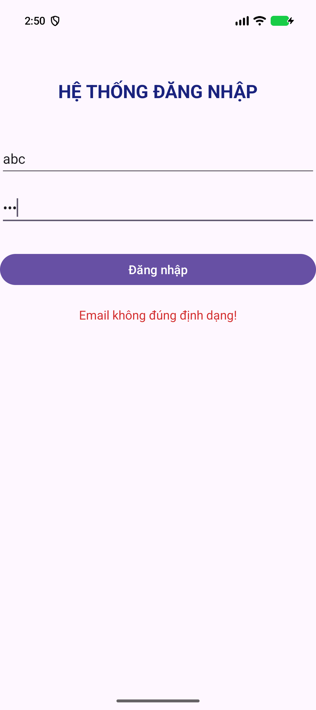
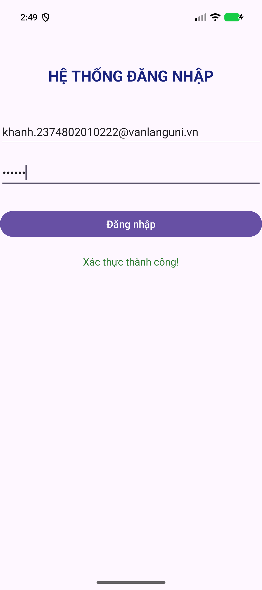

# BÀI THI THỰC HÀNH - LẬP TRÌNH ỨNG DỤNG DI ĐỘNG

- Họ và tên: Nguyễn Nam Khánh
- MSSV: 2374802010222
- Môn học: Lập trình ứng dụng di động (Mobile App)
- Trường: Đại học Văn Lang - Khoa Công nghệ Thông tin

## Cấu trúc bài làm

| Nhánh | Nội dung |
|-------|----------|
| `main` | Khung dự án ban đầu (template Empty Views Activity) |
| `cau-1` | Câu 1: Màn hình Đăng nhập và xác thực dữ liệu |
| `cau-2` | Câu 2: Điều hướng Intent và truyền dữ liệu sang ProfileActivity |
| `cau-3` | Câu 3: Danh sách động với ListView + ArrayAdapter + Toast |

# BÀI THI THỰC HÀNH - CÂU 1

- Họ và tên: Nguyễn Nam Khánh
- MSSV: 2374802010222

## Nội dung đã thực hiện

- Màn hình `LoginActivity` thiết kế bằng `ConstraintLayout` phẳng gồm: tiêu đề, ô nhập Email, ô nhập Mật khẩu, nút "Đăng nhập" và `TextView` trạng thái.
- Ánh xạ toàn bộ View bằng `findViewById` (không dùng ViewBinding).
- Xử lý sự kiện click nút "Đăng nhập" với các kiểm tra:
  - Bỏ trống Email hoặc Mật khẩu → thông báo lỗi tương ứng.
  - Email sai định dạng (kiểm tra bằng `Patterns.EMAIL_ADDRESS`) → "Email không đúng định dạng!".
  - Mật khẩu nhỏ hơn 6 ký tự → "Mật khẩu phải có ít nhất 6 ký tự!".
  - Dữ liệu hợp lệ → "Xác thực thành công!".

## Minh chứng Câu 1

